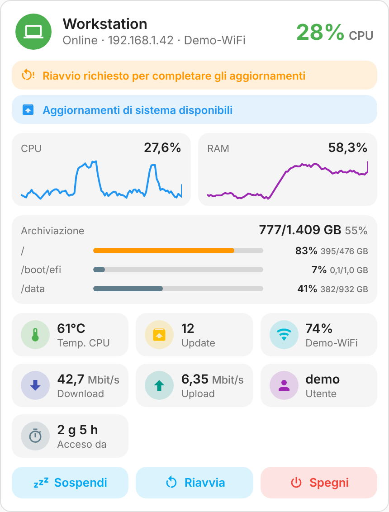

# LNXlink Card

[](https://hacs.xyz/docs/faq/custom_repositories/)
[](https://github.com/artech-lab/lnxlink-card/releases)
[](https://github.com/artech-lab/lnxlink-card/actions/workflows/validate.yml)
[](LICENSE)

[English](README.md) | **Italiano**

Una card per le dashboard di Home Assistant dedicata ai computer Linux monitorati con
[LNXlink](https://github.com/bkbilly/lnxlink): stato online, grafici di CPU e RAM, archiviazione,
temperatura, rete, utente connesso, tempo di accensione, aggiornamenti in sospeso, avvisi e pulsanti di
alimentazione. Aggiungila e trova il computer da sola: niente helper, niente template, niente YAML.



<sub>Immagine realizzata con dati dimostrativi fittizi.</sub>

## Funzionalità

- **Nessuna configurazione**: il computer LNXlink e tutte le sue entità vengono trovati dal registro dei
  dispositivi, anche se le hai rinominate. Con più computer, scegli quale nell'editor visuale.
- **Intestazione** con stato online (dal sensore LWT di LNXlink), indirizzo IP, rete Wi-Fi e carico attuale
  della CPU.
- **Grafici di CPU e RAM** delle ultime ore (3 di default), dalla cronologia del recorder, aggiornati ogni
  minuto.
- **Archiviazione**: una barra per partizione con spazio usato / totale, arancione dall'80 %, rossa dal 90 %,
  e il totale di tutte le partizioni.
- **Dettagli**: temperatura della CPU (preferito il sensore del package), aggiornamenti di sistema in
  sospeso, segnale Wi-Fi, velocità di download e upload, utente connesso e tempo di accensione.
- **Avvisi**: riavvio richiesto, aggiornamenti di sistema disponibili, nuova versione di LNXlink.
- **Pulsanti di alimentazione**: sospendi, riavvia e spegni; riavvio e spegnimento chiedono un secondo
  tocco. I pulsanti sono disattivati mentre il computer è offline.
- **Layout stabile**: a computer spento la card mantiene le sue sezioni e mostra dei trattini, così la
  dashboard non salta. Per nasconderla usa le condizioni di visibilità di Home Assistant.
- **Inglese e italiano**, secondo la lingua e il formato dei numeri del profilo di Home Assistant.
- **Aspetto nativo**: colori del tema, modalità chiara e scura, layout a sezioni, navigabile da tastiera,
  editor visuale per ogni opzione. Tocca un valore per aprire la sua entità.

## Requisiti

- Home Assistant 2024.8 o successivo.
- [LNXlink](https://github.com/bkbilly/lnxlink) installato sul computer, collegato al broker MQTT di Home
  Assistant con il discovery MQTT attivo (impostazione predefinita). Ogni modulo di LNXlink aggiunge la sua
  parte della card: quello che manca viene semplicemente saltato.

## Installazione

### HACS (consigliato)

[](https://my.home-assistant.io/redirect/hacs_repository/?owner=artech-lab&repository=lnxlink-card&category=plugin)

1. In HACS (*Marketplace* da Home Assistant 2026.11) cerca **LNXlink Card**. Se non compare, aggiungi
   `https://github.com/artech-lab/lnxlink-card` come repository personalizzato di tipo **Dashboard**.
2. Scaricala. HACS aggiunge da solo la risorsa della dashboard.
3. Ricarica la pagina del browser.

### Manuale

1. Scarica `lnxlink-card.js` dall'[ultima release](https://github.com/artech-lab/lnxlink-card/releases/latest)
   e copialo in `/config/www/`.
2. *Impostazioni → Plance → ⋮ → Risorse → Aggiungi risorsa*: URL `/local/lnxlink-card.js`, tipo
   **Modulo JavaScript**.
3. Ricarica la pagina del browser.

## Utilizzo

In una dashboard: *Modifica → Aggiungi card → LNXlink Card*. Non serve altro:

```yaml
type: custom:lnxlink-card
```

Per mostrare la card solo a computer acceso, aggiungi una condizione di visibilità sul suo sensore LWT:

```yaml
type: custom:lnxlink-card
visibility:
  - condition: state
    entity: binary_sensor.my_computer_lwt
    state: "on"
```

## Configurazione

Tutte le opzioni sono facoltative e disponibili nell'editor visuale.

| Opzione | Default | Descrizione |
| --- | --- | --- |
| `device` | il primo computer LNXlink | Id del dispositivo (selettore di dispositivi nell'editor). |
| `name` | nome del dispositivo | Titolo della card. |
| `subtitle` | sistema operativo del dispositivo | Mostrato quando il computer è offline. |
| `icon` | `mdi:laptop` | Icona dell'intestazione (`mdi:laptop` diventa `mdi:laptop-off` da offline). |
| `hours_to_show` | `3` | Ore nei grafici di CPU e RAM (1–48). |
| `show_charts` | `true` | Grafici di CPU e RAM. |
| `show_storage` | `true` | Barre dell'archiviazione. |
| `show_details` | `true` | Temperatura, aggiornamenti, rete, utente e tempo di accensione. |
| `show_actions` | `true` | Pulsanti di alimentazione. |
| `confirm_actions` | `true` | Riavvio e spegnimento richiedono un secondo tocco entro 4 secondi. |

Entità, tutte trovate automaticamente; impostane una solo per sostituirla:

| Opzione | Entità LNXlink |
| --- | --- |
| `status_entity` | LWT (sensore binario) |
| `cpu_entity`, `memory_entity` | CPU Usage, Memory Usage |
| `temperature_entity` | Temperature (prima il package della CPU, poi la CPU, poi gli altri chip) |
| `disk_entities` | Disk … (lista; prima la partizione di root) |
| `wifi_entity`, `download_entity`, `upload_entity` | WiFi, Network Download, Network Upload |
| `ip_entity` | Interface … (prima wireless o cablata, per ultime le interfacce virtuali come Docker o Tailscale) |
| `users_entity`, `uptime_entity` | Current Users, Boot Time |
| `updates_count_entity`, `system_updates_entity` | System Updates Count, System Updates |
| `restart_required_entity`, `update_entity` | Required Restart, Update |
| `suspend_entity`, `restart_entity`, `shutdown_entity` | Pulsanti Suspend, Restart, Shutdown |

In [`examples/`](examples) trovi una configurazione completa.

## Come viene trovato il computer

La card cerca nel registro dei dispositivi quelli con produttore **LNXlink** e prende il primo per nome
(oppure quello indicato in `device`). Le entità vengono riconosciute dall'entity id, dal nome dell'entità o
dal nome visualizzato, quindi rinominare gli entity id non rompe la card. Le entità nascoste vengono
ignorate. Senza sensore LWT, il computer è online finché il sensore della CPU ha un valore.

## Lingue

Inglese e italiano, per la card e per l'editor visuale. La lingua segue il profilo di Home Assistant; le
altre lingue ricadono sull'inglese. I contributi di nuove lingue sono benvenuti: aggiungi un dizionario a
`LNC_I18N` con le stesse chiavi di `en`.

## Risoluzione dei problemi

- **"Nessun computer LNXlink trovato"** — verifica che il computer compaia in *Impostazioni → Dispositivi*
  con produttore LNXlink. Se il discovery MQTT è disattivato, scegli le entità nell'editor.
- **La card non compare nell'elenco** — ricarica la pagina del browser svuotando la cache dopo
  l'installazione o un aggiornamento.
- **Grafici vuoti** — i sensori di CPU e memoria devono essere registrati dal recorder (lo sono di default).
- **Pulsanti di alimentazione grigi** — il computer è offline, oppure le entità dei pulsanti non sono
  disponibili.
- **Due copie caricate** — la console del browser avvisa quando la card è caricata due volte (ad esempio una
  risorsa manuale e HACS): tieni solo `/hacsfiles/lnxlink-card/lnxlink-card.js`.

## Sviluppo

```bash
npm test             # test unitari di discovery, formattazione, cronologia e traduzioni (Node 20+)
npm install && npx playwright install chromium   # una volta, per i due comandi seguenti
npm run test:e2e     # test nel browser con un Home Assistant simulato
npm run screenshots  # rigenera le immagini in images/ con dati dimostrativi
```

Il progetto include una guida [`CLAUDE.md`](CLAUDE.md) e i comandi per
[Claude Code](https://claude.com/claude-code) (`/publish`, `/release`).

## Nota

Progetto indipendente, non affiliato a LNXlink. LNXlink è sviluppato dai suoi autori su
[bkbilly/lnxlink](https://github.com/bkbilly/lnxlink).

## Licenza

Copyright © 2026 The lnxlink-card contributors. Distribuito con licenza
[GNU General Public License v3.0 o successiva](LICENSE).
