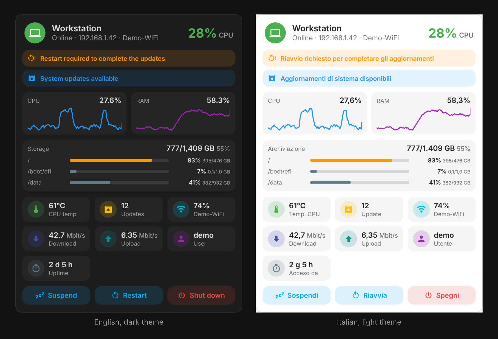

# LNXlink Card

[](https://hacs.xyz/docs/faq/custom_repositories/)
[](https://github.com/artech-lab/lnxlink-card/releases)
[](https://github.com/artech-lab/lnxlink-card/actions/workflows/validate.yml)
[](LICENSE)

**English** | [Italiano](README.it.md)

A Home Assistant dashboard card for Linux computers monitored with [LNXlink](https://github.com/bkbilly/lnxlink):
online status, CPU and RAM charts, storage, temperature, network, logged-in user, uptime, pending updates,
alerts and power buttons. Add it and it finds your computer by itself: no helpers, no templates, no YAML.



<sub>Screenshots made with fictional demo data.</sub>

## Features

- **Zero configuration**: the LNXlink computer and all its entities are found through the device registry,
  even if you renamed them. With more than one computer, pick one in the visual editor.
- **Header** with online status (from the LNXlink LWT sensor), IP address, Wi-Fi network and the current
  CPU load.
- **CPU and RAM charts** of the last hours (3 by default), from the recorder history, refreshed every
  minute.
- **Storage**: one bar per partition with used / total space, orange from 80 %, red from 90 %, and the
  total of all partitions.
- **Details**: CPU temperature (the package sensor is preferred), pending system updates, Wi-Fi signal,
  download and upload rate, logged-in user and uptime.
- **Alerts**: restart required, system updates available, new LNXlink version.
- **Power buttons**: suspend, restart and shut down; restart and shut down ask for a second tap. The buttons
  are disabled while the computer is offline.
- **Stable layout**: when the computer is off the card keeps its sections and shows dashes, so the dashboard
  does not jump. Use the visibility conditions of Home Assistant to hide the card if you prefer.
- **English and Italian**, following the language and number format of your Home Assistant profile.
- **Native look**: theme colours, light and dark mode, sections layout, keyboard accessible, a visual editor
  for every option. Tap any value to open its entity.

## Requirements

- Home Assistant 2024.8 or newer.
- [LNXlink](https://github.com/bkbilly/lnxlink) on the computer, connected to the MQTT broker of Home
  Assistant with MQTT discovery enabled (the default). Each LNXlink module adds its part of the card: the
  card simply skips what is not there.

## Installation

### HACS (recommended)

[](https://my.home-assistant.io/redirect/hacs_repository/?owner=artech-lab&repository=lnxlink-card&category=plugin)

1. In HACS (*Marketplace* from Home Assistant 2026.11) search for **LNXlink Card**. If it is not listed, add
   `https://github.com/artech-lab/lnxlink-card` as a custom repository with type **Dashboard**.
2. Download it. HACS adds the dashboard resource by itself.
3. Reload the browser page.

### Manual

1. Download `lnxlink-card.js` from the [latest release](https://github.com/artech-lab/lnxlink-card/releases/latest)
   and copy it to `/config/www/`.
2. *Settings → Dashboards → ⋮ → Resources → Add resource*: URL `/local/lnxlink-card.js`, type
   **JavaScript module**.
3. Reload the browser page.

## Usage

In a dashboard: *Edit → Add card → LNXlink Card*. Nothing else is needed:

```yaml
type: custom:lnxlink-card
```

To show the card only while the computer is on, add a visibility condition on its LWT sensor:

```yaml
type: custom:lnxlink-card
visibility:
  - condition: state
    entity: binary_sensor.my_computer_lwt
    state: "on"
```

## Configuration

Every option is optional and available in the visual editor.

| Option | Default | Description |
| --- | --- | --- |
| `device` | the first LNXlink computer | Device id of the computer (device picker in the editor). |
| `name` | device name | Card title. |
| `subtitle` | operating system of the device | Shown while the computer is offline. |
| `icon` | `mdi:laptop` | Header icon (`mdi:laptop` becomes `mdi:laptop-off` when offline). |
| `hours_to_show` | `3` | Hours in the CPU and RAM charts (1–48). |
| `show_charts` | `true` | CPU and RAM charts. |
| `show_storage` | `true` | Storage bars. |
| `show_details` | `true` | Temperature, updates, network, user and uptime. |
| `show_actions` | `true` | Power buttons. |
| `confirm_actions` | `true` | Restart and shut down need a second tap within 4 seconds. |

Entities, all found automatically; set one only to override it:

| Option | LNXlink entity |
| --- | --- |
| `status_entity` | LWT (binary sensor) |
| `cpu_entity`, `memory_entity` | CPU Usage, Memory Usage |
| `temperature_entity` | Temperature (CPU package first, then CPU, then other chips) |
| `disk_entities` | Disk … (list; root partition first) |
| `wifi_entity`, `download_entity`, `upload_entity` | WiFi, Network Download, Network Upload |
| `ip_entity` | Interface … (wireless or wired first, virtual interfaces such as Docker or Tailscale last) |
| `users_entity`, `uptime_entity` | Current Users, Boot Time |
| `updates_count_entity`, `system_updates_entity` | System Updates Count, System Updates |
| `restart_required_entity`, `update_entity` | Required Restart, Update |
| `suspend_entity`, `restart_entity`, `shutdown_entity` | Suspend, Restart, Shutdown buttons |

See [`examples/`](examples) for a full configuration.

## How the computer is found

The card looks in the device registry for devices made by **LNXlink** and takes the first one by name
(or the one set in `device`). Its entities are recognized by the entity id, the entity name or the friendly
name, so renaming the entity ids does not break the card. Hidden entities are ignored. Without an LWT
sensor, the computer is online while its CPU sensor has a value.

## Languages

English and Italian, for the card and the visual editor. The language follows the Home Assistant profile;
any other language falls back to English. Contributions of new languages are welcome: add a dictionary to
`LNC_I18N` with the same keys as `en`.

## Troubleshooting

- **"No LNXlink computer found"** — check that the computer appears in *Settings → Devices* with
  manufacturer LNXlink. If MQTT discovery is off, pick the entities in the editor.
- **The card is not in the card picker** — reload the browser page with a cleared cache after installing or
  updating.
- **Empty charts** — the CPU and memory sensors must be recorded by the recorder (they are by default).
- **The power buttons are greyed out** — the computer is offline, or the button entities are unavailable.
- **Two copies loaded** — the browser console warns when the card is loaded twice (for example a manual
  resource and HACS): keep only `/hacsfiles/lnxlink-card/lnxlink-card.js`.

## Development

```bash
npm test             # unit tests of discovery, formatting, history and translations (Node 20+)
npm install && npx playwright install chromium   # once, for the two commands below
npm run test:e2e     # browser tests with a simulated Home Assistant
npm run screenshots  # regenerates the images in images/ with demo data
```

The project includes a [`CLAUDE.md`](CLAUDE.md) guide and slash commands for
[Claude Code](https://claude.com/claude-code) (`/publish`, `/release`).

## Disclaimer

This is an independent project, not affiliated with LNXlink. LNXlink is developed by its own authors at
[bkbilly/lnxlink](https://github.com/bkbilly/lnxlink).

## License

Copyright © 2026 The lnxlink-card contributors. Released under the
[GNU General Public License v3.0 or later](LICENSE).
